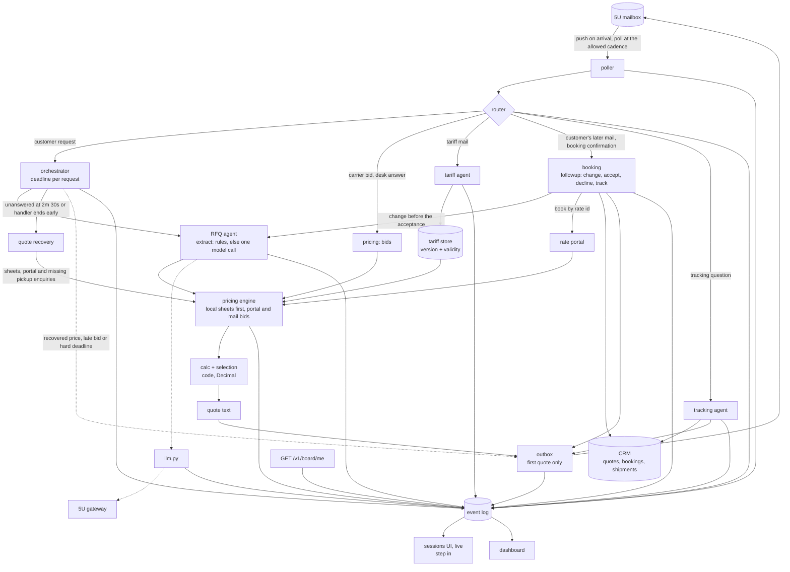

# PIXEL

A digital air forwarder for the 5U AI challenge at START Hack Munich 2026, "Who answers at 2 a.m.?". It reads one
mailbox, prices every air export request from tariff sheets, the rate portal and carrier bids, quotes within
minutes, books when the customer accepts and answers tracking questions from its own CRM. A person can watch every
session live and step in.



## Run it

```sh
uv sync
cp .env.example .env                       # fill in the keys; PIXEL_DRY_RUN=1 sends nothing
uv run python -m tools.set_openai_key      # once
uv run uvicorn pixel.app:app --port 8000   # http://localhost:8000
uv run pytest -q
```

## How it scores

Up to 100 points per accepted quote: 45 for price accuracy, 40 for low model cost, 15 for response time. A quote is
accepted only within 5% of the best price, and only as our first reply within 6 minutes; when the customer changes the
request, our answer to the change mail is the one scored (round 86). Code calculates the price.
A request normally uses one small gateway call.

During a portal outage, a request with a sheet price can wait until 115 seconds after receipt for a pending rate
desk reply. If the desk stays silent, PIXEL quotes the best price it has.

If the normal handler ends without a quote, or the request is still unanswered 2 minutes 30 seconds after receipt,
the orchestrator takes over. It checks stored prices and runs a short second sourcing pass if needed. PIXEL can wait
for a price that meets an explicit airline, arrival or transit requirement. It labels any alternative at the deadline. A door-to-port
quote includes a trucker price. If only air freight is priced, PIXEL keeps the request open for late
pickup bids. At the hard deadline it can send the airport-to-airport price with pickup explicitly excluded. If no freight rate
is available, it replies that it could not obtain one in time. If the
customer omitted the postcode, the quote asks for the pickup address. With no air price at all the round is recorded
as missed. A customer question about an offer goes to the operator. An affirmative instruction to book a delivered
offer starts the booking.

The Performance dashboard leads with our rank in big, the team total and the gap to the teams around us
(`GET /v1/board`), then shows the team total from `GET /v1/board/me`, split into what the quotes earned
(accuracy, time, cost) and what comes on top (human writing, tracking); the board's `booking` field is always 0. Per round it lists every kind; an accepted round
shows "being scored" until the scorer adds its accuracy and time when the round closes (`core/feedback.py` explains
a round only then). Cost points the scorer adds only after the
hour are estimated from our own gateway spend in that hour (R28), counted in the round's quote and total, and shown as a
projected total.

The Night shift page (`/night`, `pixel/ui/nightshift.py`) shows how the service repairs itself: every scored round as
a strip, then per run of lost rounds the change merged for it, when the host's deploy job tested it and put it live,
and the next accepted round, with the time to repair. A change belongs to a run when its commit message names one of
the run's rounds, or its reason and no round. It reads the `feedback` events, `/opt/pixel/cd/cd.log` (world-readable)
and `git log` of the live checkout; nothing else is needed on the host.

## Team

Five people, five roles. Each role has one number it answers for and files it reviews
([`.github/CODEOWNERS`](.github/CODEOWNERS)). The first three carry the score, the fourth keeps it when the setup
changes, the fifth makes the jury see it.

| # | Role | Answers for | Who |
| --- | --- | --- | --- |
| 1 | Cost | 40 points: gateway spend per accepted quote | tbd |
| 2 | Speed | 15 points, and no request missed in 6 minutes | tbd |
| 3 | Accuracy | 45 points, and the 5% limit that decides acceptance | tbd |
| 4 | Generalization | Accepted rate after every unannounced change | tbd |
| 5 | Frontend, business and pitch | UX and design, how human our mails read, the pitch | tbd |

### 1. Cost: the one who counts every call

- **Thinks:** a model call is a purchase. What did it buy that a rule could not?
- **Owns:** `pixel/llm.py`, `pixel/agents/rfq/extract.py`, `pixel/agents/rfq/compose.py`, every prompt.
- **Watches:** spend per accepted quote per 18-minute window, calls per quote, tokens per call, share of requests read by rules alone.
- **Asks of every change:** does this add a call, a longer prompt or a bigger model, and is one call per quote still true?
- **First tasks:** the smallest model that extracts reliably; a rule for every request the model read twice the same way;
  a budget per session that a runaway loop cannot pass.

### 2. Speed: the one who watches the clock

- **Thinks:** a late right answer scores nothing. Every request ends in a sent quote, whatever broke on the way.
- **Owns:** `pixel/core/`, `pixel/agents/router/`, `pixel/api/`, `pixel/app.py`, the live process and its restarts.
- **Watches:** seconds from the request to our reply, missed requests, fallbacks sent, time lost per stage.
- **Asks of every change:** what happens to this request if the step hangs, the API answers 429 or 503, or we restart now?
- **First tasks:** a response-time histogram per stage; when waiting for a bid is worth the seconds; an alert when two
  quotes in a row fail.

### 3. Accuracy: the one who reads the small print

- **Thinks:** 5% above the best price is zero points. The best price is not always the obvious one.
- **Owns:** `pixel/pricing/`, `pixel/agents/tariffs/`, the tests of both, [`docs/calc.md`](docs/calc.md).
- **Watches:** accepted rate, accuracy points per quote, the reason code of every rejection.
- **Asks of every change:** which rule in [`docs/RULES.md`](docs/RULES.md) is this, and which test would fail without it?
- **First tasks:** every rejected quote becomes a replayed mail and a fix; the answers to the open pricing questions
  (plan §0) replace the assumptions; new tariff versions take over on their validity date.

### 4. Generalization: the one who expects the next surprise

- **Thinks:** the start kit is one version of the world. What arrives at 3 a.m. looks different.
- **Owns:** `tests/fixtures/` (captured mail, hand-calculated prices, written variants), the Pitfalls section of every
  agent README, the change log in [`bench/RUNS.md`](bench/RUNS.md).
- **Watches:** accepted rate in the hour after a change, mails the router could not place, tariffs that failed to ingest.
- **Asks of every change:** does this hold for a mail we have not seen: another language, another unit, another layout?
- **First tasks:** twenty prices calculated by hand as a second opinion on `calc.py`; every parsed tariff read against
  its file; the same request written ten ways; each real mail labelled with what was asked and what was right.
- Works in fixtures and spreadsheets, not in pipeline code: needs the domain, not the toolchain.

### 5. Frontend, business and pitch: the one the jury meets

- **Thinks:** the jury judges what it can see and read: the screen, our mails, three minutes on stage.
- **Owns:** `pixel/ui/page.py` (everything visible of the sessions UI and dashboard), the wording of our mails
  (with Cost, who owns the code around it), the pitch and the demo path, the line to the 5U team.
- **Watches:** can a stranger find a session and step in within ten seconds; would a customer take our mail for a person's.
- **Asks of every change:** would I understand this screen at 2 a.m., and would I send this mail under my own name?
- **First tasks:** the open questions to 5U (plan §0); five model mails in the voice we want; the story of the pitch,
  shown on live sessions, not on slides.

Shared by all, reviewed by whoever did not write the change: `pixel/crm/`, `pixel/ui/routes.py`,
`pixel/ui/dashboard.py`, `pixel/agents/rfq/booking.py`, `pixel/agents/tracking/`, `pixel/contracts.py`, `docs/`,
`tools/`. Through the night everyone takes a shift at the dashboard.

## Read on

- [`AGENTS.md`](AGENTS.md): for coding agents: non-negotiables, where things live, who owns what, commands
- [`docs/challenge.md`](docs/challenge.md): the challenge as given
- [`docs/RULES.md`](docs/RULES.md): every rule we are scored by, numbered, with its source and its place in code
- [`docs/IMPLEMENTATION_PLAN.md`](docs/IMPLEMENTATION_PLAN.md): open questions, the system, the backlog, the work split
- [`bench/RUNS.md`](bench/RUNS.md): our results per request

## Status

The foundation is built: mail pipeline, pricing, CRM, booking, tracking and the sessions UI, tested offline. Mail
fixtures include captured challenge traffic and synthetic edge cases. Open pricing assumptions are tracked in the plan and
[`docs/calc.md`](docs/calc.md).
