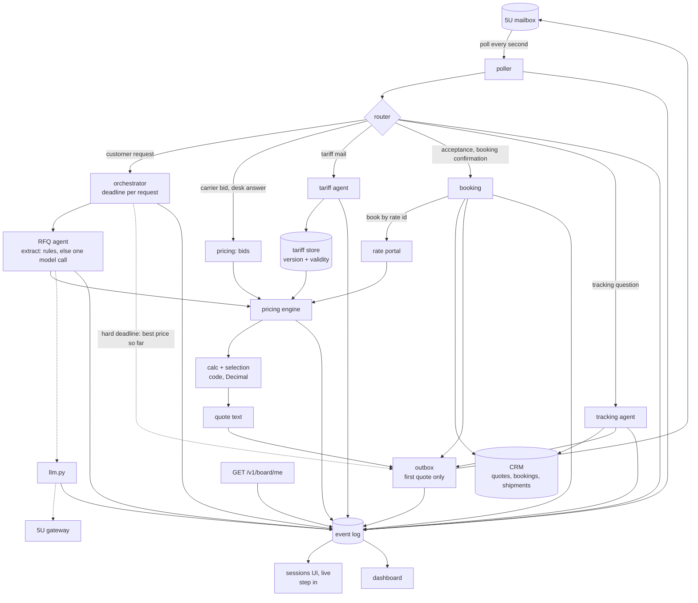

# PIXEL

A digital air forwarder for the 5U AI challenge at START Hack Munich 2026, "Who answers at 2 a.m.?". It reads one
mailbox, prices every air export request from tariff sheets, the rate portal and carrier bids, quotes within
minutes, books when the customer accepts and answers tracking questions from its own CRM. A person can watch every
session live and step in.



## Run it

```sh
uv sync
cp .env.example .env                       # fill in the keys; PIXEL_DRY_RUN=1 sends nothing
uv run python -m tools.set_openai_key      # once
uv run uvicorn pixel.app:app --port 8000   # http://localhost:8000
uv run pytest -q
```

## How it scores

Up to 100 points per accepted quote: 45 for price accuracy, 40 for low model cost, 15 for response time. A quote is
accepted only within 5% of the best price, and only as our first reply within 6 minutes. So: code does all the
arithmetic, a model is called once per quote at most, and every request has a deadline that always ends in an
answer.

## Read on

- [`AGENTS.md`](AGENTS.md): for coding agents: non-negotiables, where things live, who owns what, commands
- [`docs/challenge.md`](docs/challenge.md): the challenge as given
- [`docs/RULES.md`](docs/RULES.md): every rule we are scored by, numbered, with its source and its place in code
- [`docs/IMPLEMENTATION_PLAN.md`](docs/IMPLEMENTATION_PLAN.md): open questions, the system, the backlog, the work split
- [`bench/RUNS.md`](bench/RUNS.md): our results per request

## Status

The repo holds the plan and the typed skeleton. Every function is a stub with its contract; the three foundation
packages fill them in ([plan §6](docs/IMPLEMENTATION_PLAN.md#6-foundation-three-work-packages)).
